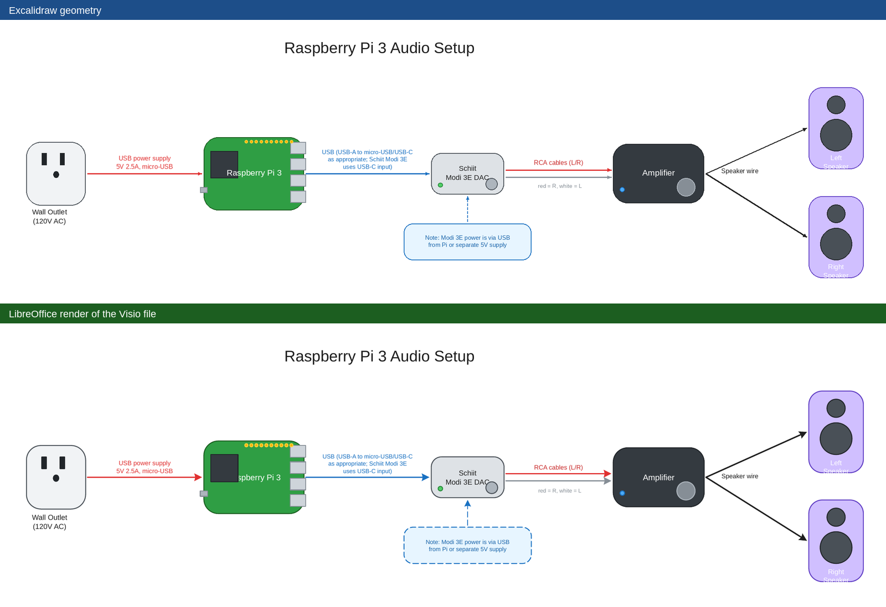
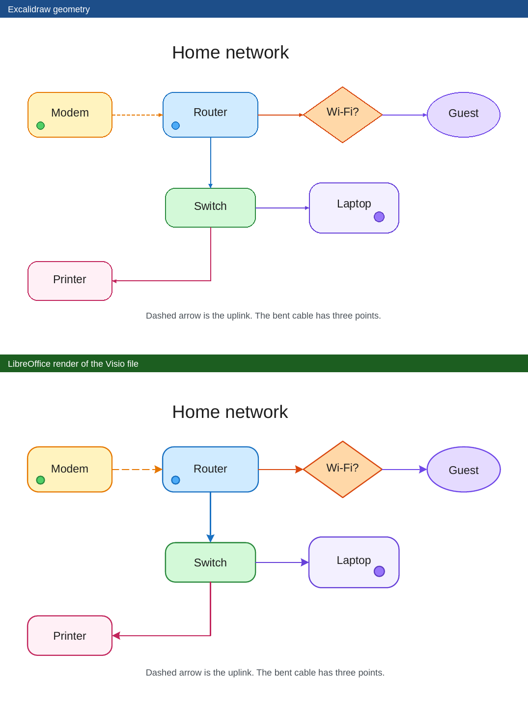

# excalidraw2vsdx

Convert an [Excalidraw](https://excalidraw.com) drawing into a native Microsoft Visio `.vsdx` file.

This is a standalone converter, not a fork of Excalidraw. It reads Excalidraw JSON (a `.excalidraw` scene or an `.excalidrawlib` library) and writes an Open Packaging Convention package that Visio and LibreOffice Draw open as a drawing. Shapes are real Visio geometry, not a picture of the canvas. Arrows that are bound to shapes are connectors glued to connection points, so they stay attached when a shape moves.

Author: Justin Powell. License: [MIT](LICENSE).

## Previews

Each picture shows the source geometry on top and LibreOffice Draw’s rendering of the converted `.vsdx` underneath. The top panel redraws positions, colors, and labels from the Excalidraw file. The bottom panel is the Visio file opened by LibreOffice.

Raspberry Pi audio chain:



Home network (rectangles, ellipses, a diamond, bound text, glued arrows, a three-point cable, and groups):



## Features

- Rectangles, including adaptive and proportional rounded corners drawn as real arcs
- Ellipses and diamonds sized to the original box
- Standalone text and text bound to a shape or arrow, with no fill and no text-background plate
- Arrows and multi-point lines that keep the source path, with arrowheads and glue when a binding exists
- Groups, rotation, and embedded png, jpeg, gif, and bmp images
- One Visio page per item in an `.excalidrawlib` library
- A browser page that converts the file locally, and a Docker image for Apple Silicon and Intel

## Quick start

You need Node.js 20 or newer.

```bash
git clone https://github.com/powelljustin/excalidraw2vsdx.git
cd excalidraw2vsdx
npm install
npm run build
node dist/cli/excalidraw2vsdx.js test/fixtures/home-network.excalidraw -o home-network.vsdx
```

Without a local Node install, use Docker. The short version is below. [docs/DOCKER.md](docs/DOCKER.md) walks through installing Docker Desktop, the volume mount, Windows paths, and how to stop the container.

```bash
docker build -t excalidraw2vsdx .
docker run --rm -p 8080:8080 excalidraw2vsdx
```

Open [http://localhost:8080](http://localhost:8080).

## Command line

```bash
npx tsx cli/excalidraw2vsdx.ts diagram.excalidraw -o diagram.vsdx
```

After `npm run build`:

```bash
node dist/cli/excalidraw2vsdx.js diagram.excalidraw -o diagram.vsdx
```

```
excalidraw2vsdx <input.excalidraw> [-o out.vsdx] [options]
excalidraw2vsdx <input.excalidrawlib> [-o out.vsdx]

  -o, --output <file>     Output path. Default: input name with .vsdx
      --px-per-inch <n>   Scene pixels per Visio inch (default 96)
      --margin <inches>   Blank margin around the drawing (default 0.5)
  -h, --help
```

A library file becomes one Visio page per item. The command prints page size and counts, plus a note when something was simplified (roughness, a pattern fill, or a missing image).

Inside the Docker image the same tool is the `cli` command. See [docs/DOCKER.md](docs/DOCKER.md).

## Web page

The page converts entirely in the browser. Nothing is uploaded.

```bash
npm run dev
```

Open [http://127.0.0.1:47321](http://127.0.0.1:47321), drop an `.excalidraw` or `.excalidrawlib` file, and download the `.vsdx`.

To build the static files yourself:

```bash
npm run build:web
```

Serve the `dist-web/` directory with any static file server. The Docker image does this on port 8080.

## Library

```ts
import { readFileSync, writeFileSync } from "node:fs";
import { convertExcalidraw } from "excalidraw2vsdx";

const result = convertExcalidraw(readFileSync("diagram.excalidraw", "utf8"), {
  pxPerInch: 96,
  marginInches: 0.5,
  title: "Diagram",
});

writeFileSync("diagram.vsdx", result.vsdx);
```

`convertExcalidraw` accepts a JSON string or an already-parsed scene, element array, or library. The result is `{ vsdx, pages, warnings }`. `vsdx` is a `Uint8Array`.

## What is mapped

| Excalidraw | Visio |
| --- | --- |
| Rectangle, including adaptive and proportional rounded corners | 2-D shape with quarter-circle corner arcs (not the Rounding cell, which LibreOffice ignores). Proportional radius is 25% of the shorter side; adaptive radius is 32px until the shorter side is small enough to use the proportional value. |
| Ellipse | Ellipse fitted to the shape box. The geometry cells store the real center and radii (LibreOffice draws those cached values and does not evaluate `Width*` / `Height*`) |
| Diamond | Diamond geometry |
| Fill color, stroke color, stroke width | `FillForegnd`, `LineColor`, `LineWeight` |
| Dashed / dotted stroke | Line pattern 2 / 3 |
| Opacity | Fill and line transparency |
| Standalone text | Text-only shape with no fill and no line. Font size, color, alignment, and opacity are kept. The block sits on the original text rectangle. |
| Text bound to a shape or arrow | Text on that shape or connector, with no text-background plate, placed on the original text rectangle (a caption stays where it was drawn; it is not recentered on the whole shape) |
| Transparent `backgroundColor` | No fill (`FillPattern` 0 and geometry `NoFill`) |
| Line | Polyline. A line with arrowheads, bindings, or more than two points is a connector. |
| Arrow | Connector with an end arrowhead. The path is the original polyline (straight or multi-segment), in a box tall enough to hold the label, so a diagonal is not flipped by a negative height. |
| `startBinding` / `endBinding` | Connection point on the target, plus a `Connect` and a `PAR(PNT(...))` glue formula, so the end stays attached when the shape moves |
| Freedraw | Polyline, slightly simplified |
| Image (`png`, `jpeg`, `gif`, `bmp` data URL) | Embedded picture (`ForeignData`) |
| Group | Visio group |
| Frame | Rectangle labeled with the frame name |
| Embed / iframe | Labeled placeholder rectangle |
| Rotation (`angle`) | Shape angle. Excalidraw’s clockwise radians become Visio’s counterclockwise angle. |
| Several library items | One page each |

Arrowheads: `arrow`, `triangle`, `bar`, `dot` / `circle`, `diamond`, and the crow’s-foot variants map to the closest Visio arrowhead index. An Excalidraw `arrow` with no explicit head still gets an end arrow.

Fonts: family 1 and 5 (Virgil, Excalifont) become Segoe Print; 2, 6, and 10 (Helvetica, Nunito, Lilita) become Arial, which is the closest face Visio ships to Helvetica; 3 (Cascadia) becomes Consolas; 7 and 9 (Assistant, Liberation) become Arial; 8 (Comic Shanns) becomes Comic Sans MS. Those faces are listed in the document so Visio does not ask for a missing font. Line spacing is the Excalidraw line height as an absolute pitch (`fontSize × lineHeight` at 96px per inch).

Coordinates: Excalidraw pixels, origin top-left, y down. Visio inches, origin bottom-left, y up. The default scale is 96 pixels per inch. The page is sized to the drawing plus a 0.5 inch margin.

## Package

The `.vsdx` is a zip with the parts Visio expects:

- `[Content_Types].xml`
- `_rels/.rels`
- `docProps/core.xml`, `docProps/app.xml`, `docProps/custom.xml`
- `visio/document.xml` (face names and the built-in style sheets)
- `visio/pages/pages.xml` and `visio/pages/page1.xml` (and further pages)
- `visio/windows.xml`
- `visio/media/` when the drawing has images

Shapes are written as geometry on the page. There is no stencil, so Visio does not try to repair a missing master.

## Samples

Two drawings live in `test/fixtures/` and are covered by the tests:

- `pi-audio-chain.excalidraw` is a device diagram with rounded rectangles, small ellipses (GPIO pins, knobs, speaker drivers, an LED), bound captions, dashed and diagonal arrows, and glued endpoints.
- `home-network.excalidraw` is a small network sketch with rectangles, ellipses, a diamond, standalone and bound text, glued arrows, a three-point cable, and three groups.

## Limitations

- Hand-drawn roughness is dropped. Strokes are clean. A note is recorded when the source had roughness. Both sample drawings are already smooth (`roughness: 0`).
- Hachure, cross-hatch, and zigzag fills become a solid color.
- Freedraw is a polyline. Points closer than about 1.25px are dropped. It is not a Visio ink stroke.
- The painted arrow is the original polyline. Glued ends are connection points on the same side as the Excalidraw binding, but Visio does not reroute bends when a shape is dragged, and the glue does not slide along the outline.
- Arrowheads are Visio’s arrowhead at a size chosen from the stroke width, not Excalidraw’s exact triangle.
- Text uses Arial, Consolas, or Segoe Print. LibreOffice, which often has none of those, substitutes Arimo for Arial. Glyph shapes differ slightly from Helvetica, and a short label is given a little extra width so the substitute does not wrap. The extra width grows away from the alignment anchor.
- Only `png`, `jpeg`, `gif`, and `bmp` images are embedded. Anything else becomes a placeholder rectangle.
- Frames, embeds, and iframes are rectangles with a label. Linked frames keep the link as a hyperlink.
- Deleted elements are skipped. Unsupported element types are skipped and reported.
- There are no layers, and the drawing grid is not copied. The page adds a 0.5 inch margin around the drawing.

## Development

```bash
npm install
npm test
npm run build
npm run build:web
npm run dev
```

`npm test` runs the unit and integration tests. When LibreOffice (`soffice`) and `pdftoppm` are installed, it also renders both sample drawings to PNG under `tmp/render/`. That step is skipped when LibreOffice is not installed, which is the case on the GitHub runner.

Unit tests cover color, corner radius, coordinate conversion, rotation, text, glue, groups, freedraw, images, and libraries. Integration tests convert `test/fixtures/pi-audio-chain.excalidraw` and `test/fixtures/home-network.excalidraw` and check the package parts and page XML.

## Project structure

```
cli/                 Command-line entry
src/                 Converter, geometry, colors, and the Visio package writer
web/                 Browser page (Vite). Conversion stays in the browser.
docker/              Container entrypoint and the small static file server
test/fixtures/       Sample drawings
test/                Vitest tests
docs/DOCKER.md       Docker install and run guide
docs/images/         Before/after preview images
Dockerfile           Multi-stage image (Node build, then Node 22 Alpine on port 8080)
docker-compose.yml   Publishes 8080 and restarts unless stopped
```

## Contributing

See [CONTRIBUTING.md](CONTRIBUTING.md). Issues and pull requests are welcome. The changelog is [CHANGELOG.md](CHANGELOG.md).

## License

MIT. Copyright (c) 2026 Justin Powell. See [LICENSE](LICENSE).
